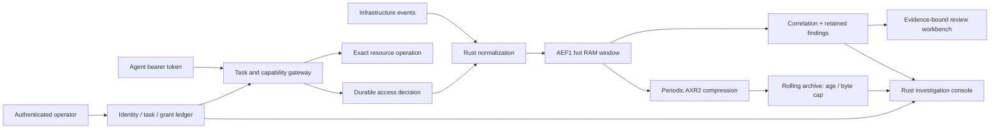

# Athernex — a datacenter in one rack

A Rust systems research lab for a compact datacenter: security intelligence, evidence-based automation, workload orchestration, and resource efficiency in one inspectable control plane.

**Deployable single-host slice:** a Rust SIEM collecting real Linux system and authentication events from journald, with managed sources, analyst-owned investigations, five rule contracts, task-bound agent capabilities, and rolling compressed history. The application and its server-rendered console run in Rust. No frontend framework, JavaScript application, Docker stack, or model download is required.

**Research ambition:** coordinate a rack's security, compute, storage, and AI workloads under one resource budget. Operational mode reads real connected sources. Public screenshots and reproducible experiments use explicitly controlled fixtures. Broad production detection coverage and rack-wide performance remain unmeasured.

[Platform overview](docs/siem-enterprise.md) · [Integration catalog](docs/siem-integrations.md) · [Crustation migration](docs/crustation-migration.md)

[Install on Linux](#deploy-on-linux-with-systemd) · [Launch the console](#run-the-siem) · [What works](#what-works-today) · [Agent hive](#an-agent-hive-inside-the-siem) · [Rolling memory](#rolling-memory-with-an-explicit-budget) · [Research findings](#research-findings) · [Big-push roadmap](#big-push-roadmap) · [Three-minute demo](#a-three-minute-demo) · [Existing staging](#local-staging)


[Agent hive](docs/assets/siem-hive.png) · [Identity investigation](docs/assets/siem-agent.png) · [Rolling memory](docs/assets/siem-retention.png) · [Event byte inspector](docs/assets/siem-event.png) · [Evidence-bound review workbench](docs/assets/siem-workbench.png)

**Console gallery:** eight actual Rust console captures in a forest-green and cyan palette. Overview, hive, identity, event, review and retention views use the explicit synthetic demo; source and case views use an isolated operational ledger with public fixtures. No host journal, private identifiers or credentials appear. [Capture provenance](docs/assets/siem-screenshots.json) · [Reproduce the gallery](tools/verify_siem_ui.cjs).

## Endpoint convergence · Project Crustation

**I’m working on migrating Project Crustation’s endpoint AV capabilities into this agentic SIEM and orchestration layer.** The source repository is published as [Project Crustacian](https://github.com/CharlesDerek/crustacian): Rust endpoint tooling, ClamAV scanning and a durable telemetry path. Athernex will bring selected endpoint evidence into shared investigations, then connect reviewed work to scoped endpoint actions.

The compatibility bridge and endpoint response path are planned migration work. The [migration brief](docs/crustation-migration.md) records the concrete findings: preserve durable acknowledgements before advancing an endpoint spool; retain full identity and evidence hashes; add typed endpoint semantics; and keep response recommendations separate from execution authority. The [integration catalog](docs/siem-integrations.md) distinguishes current interfaces from proposed connectors.

## Run the SIEM

```bash
make run-siem
# Open http://127.0.0.1:8787
# In another terminal, print the sign-in key:
make siem-key
```

Requires Rust **1.89+**, a C compiler for bundled SQLite, Linux and `/usr/bin/journalctl` for live collection. Dependencies are locked. **Operational mode is the default:** it starts a `host-journal` source with a five-minute lookback, then follows checkpointed cursors. There are no seeded events, findings or agent identities. A quiet host can legitimately have zero findings.

**Run `make siem-key` and paste its output into “Operator key.”** Both Makefile launch commands use the same private key file as the systemd installation, `~/.config/athernex-siem/operator.key`. They create it only when missing and reuse it on later starts; an inherited `ATHERNEX_OPERATOR_KEY` cannot override this explicit file. To prepare the key before starting a server, run `make siem-init`. These commands do not enable or start a background service. Stop a foreground server with **Ctrl+C**.

If an older manually launched server is still using a temporary terminal key, stop that process and restart it with `make run-siem` once. `make siem-key` reads the saved file; it cannot retrieve a different key held by an already-running process.

Direct binary/Cargo launches still support `--operator-key-file PATH` / `ATHERNEX_OPERATOR_KEY` (at least 24 characters), or print a temporary key in an interactive terminal when neither is supplied. Non-interactive launches require an explicit credential; systemd never receives a printed key. The operator key is separate from source-ingest and agent-task tokens. Sessions expire after one hour; **Lock** signs out.

```bash
# Explicit, separate synthetic demonstration; no host journal collection.
make run-siem-demo

# Disposable demo; every tier is in RAM.
cargo run -p athernex-siem -- --demo --memory --port 8788

# Empty operational console for an authenticated API integration.
cargo run -p athernex-siem -- --no-journal --db .athernex/api.sqlite3 --port 8788

# Independent encoding experiment; no dependency downloads.
make research-siem
```

`make run-siem` reuses the systemd ledger at `~/.local/share/athernex-siem/siem.sqlite3`; `make run-siem-demo` keeps its separate ledger at ignored `.athernex/demo.sqlite3`. Both use stripped release builds to reuse the installed service’s build cache. Override `SIEM_DB`, `SIEM_DEMO_DB`, `SIEM_PORT` or `SIEM_KEY_FILE` as needed, for example `make run-siem SIEM_PORT=8788`. Use the same `SIEM_KEY_FILE` override with `make siem-key` if customized. Direct binary/Cargo launches retain their `.athernex/live.sqlite3` / `.athernex/demo.sqlite3` defaults. Modes are recorded in the database and cannot be mixed. An old unclassified demo ledger must be opened with `--demo`; start a fresh operational ledger. `--no-journal` disables the collector process, including registered journal sources; it does not silently reclassify them as healthy.

Defaults: 4,096 hot events, **1 MiB compressed archive payload**, a 30-day maximum archive horizon and a five-second flush interval. These are separate budgets; they do not mean 1 MiB of total disk use or guaranteed 30-day coverage. Cases, access decisions and authority changes commit immediately. See [rolling memory](#rolling-memory-with-an-explicit-budget).

## Deploy on Linux with systemd

```bash
make install-siem
# Open http://127.0.0.1:8787
make siem-key
systemctl --user status athernex-siem
curl --fail http://127.0.0.1:8787/readyz
```

The [installer](tools/install-siem-user.sh) builds one stripped release binary and installs the [user unit](infrastructure/systemd/athernex-siem.service). It creates private directories and a mode-0600 random key, preserves existing data and credentials, enables the service and restarts it. Paths are intentionally outside the repository:

| Item | Location |
| --- | --- |
| Binary | `~/.local/lib/athernex-siem/athernex-siem` |
| Operator credential | `~/.config/athernex-siem/operator.key` |
| Ledger, lock and SQLite sidecars | `~/.local/share/athernex-siem/siem.sqlite3*` |
| User service | `~/.config/systemd/user/athernex-siem.service` |

The unit uses a 256 MiB memory ceiling, 192 MiB memory-high threshold, 64-task limit, restrictive umask and `NoNewPrivileges`. These are containment settings, not measured performance claims. It binds only `127.0.0.1:8787`. Check local journal visibility with `journalctl --since=-5min --no-pager`; group membership such as `adm` or `systemd-journal` is distribution-specific. The collector can see only what its service account can read. If access fails, the source reports the error and readiness becomes degraded.

A user service follows the user manager’s lifetime. **Automatic startup before login / survival after logout requires lingering**, administered separately with `sudo loginctl enable-linger "$USER"` where appropriate. The installer does not change system accounts, group membership or lingering. See systemd’s [user service execution documentation](https://www.freedesktop.org/software/systemd/man/latest/systemd.exec.html) and [loginctl linger contract](https://www.freedesktop.org/software/systemd/man/latest/loginctl.html).

For remote use, keep the listener private and forward it with `ssh -L 8787:127.0.0.1:8787 USER@HOST`. Stop with `systemctl --user stop athernex-siem`; SIGTERM drains the collector and flushes telemetry. Rerun `make install-siem` to upgrade. Back up the private state directory **after stopping the service**, together with its key, and keep backups outside this public repository. Uninstall the unit with `systemctl --user disable --now athernex-siem`; data remains for an explicit retention decision.

`/healthz` reports process liveness. `/readyz` returns 503 on a recorded storage error, a journal error or a journal poll older than 120 seconds. `/api/state`, exports, provenance and original-message retrieval require operator authentication. Paused sources are intentionally excluded from readiness; source pages still show that they are paused. Readiness indicates configured collection health, not completeness or absence of incidents.

## Real sources and investigations


**Sources → source detail** shows accepted/skipped counts, last receipt, last poll, checkpoint state and errors. Register up to 32 sources; pause/resume, rotate an API credential or reset an unavailable journal cursor. A reset starts a five-minute lookback and can replay records outside the bounded deduplication window. Prefer one all-unit journal source or disjoint exact-unit filters to avoid collecting the same record twice.

The Rust adapter invokes `journalctl` with fixed arguments, no shell, a 3-second read deadline, 256-record / 512 KiB batch budget and 64 KiB per-line budget. Trusted `_EXE` metadata gates OpenSSH/PAM/sudo classifications; an arbitrary syslog identifier cannot impersonate `sshd`. Generic journal lines remain `SY·` observations. PID 1 / UID 0 / systemd service-failure messages can raise AX-005. This collector does **not** infer privileged execution or network byte counts from an error message; those rules require an additional source with those fields.

AEF1 holds selected facts. AXR2 additionally preserves bounded host/program/PID/UID/classification/cursor provenance. Raw `MESSAGE` text is parsed transiently and discarded. An operator can fetch the **exact original journal message on demand** while journald retains it; retrieval checks the returned cursor and caps display at 16,384 characters. API sources cannot supply collector provenance. Account names are truncated/sanitized to the documented label alphabet, so lossy identity mapping is a research limitation; the cursor is the path back to the original evidence. Late records beyond the 24-hour intake window are skipped and counted. Source outages are visible rather than filled with synthetic activity.


**Investigations → case** supports manual creation, automatic creation from detections, owner assignment, severity, open/triage/in-progress/resolved/false-positive states, notes, evidence attachment, JSON export and explicit removal of a closed case after export confirmation. Case updates carry a revision so concurrent edits cannot silently overwrite each other. Case evidence survives hot-ring and finding rotation. Limits are 256 cases, 64 attached facts and 64 notes per case; admission fails visibly when a budget fills. Closed cases are never silently purged. Deleting a case retains its resolved detection in the bounded finding ledger to avoid recreating it from the same observation.

The metric cards are links into these menus. A review plan in operational mode executes a real, limited action: after approval it moves the associated case to triage and writes an evidence-hash receipt. Expired, closed, changed or replayed plans are refused. Closing a case revokes pending approvals. Agent containment is available through explicit **Quarantine**, **Complete task** and **Revoke** controls in the hive.

## What works today

| Surface | Implemented behavior |
| --- | --- |
| Command overview | Clickable metrics, event-volume chart, actual source health, managed investigations and separate payload/database/WAL accounting. Synthetic stream controls appear only in `--demo`. |
| Event explorer | Server-side search, event-class and severity filters, pagination, per-event byte inspector, decoded facts, provenance, optional original journal lookup and evidence attachment. |
| Detection engineering | Authentication burst, login-to-privileged-execution sequence, execution-to-large-egress sequence, policy denial, and trusted systemd service failures. Rule toggles affect actual evaluation. |
| Investigation | Cases with owners, notes, severity/status, optimistic revision checks, independent evidence copies, export and explicit closed-case deletion. |
| Athernex workbench | Evidence-bound plans, 16-plan pending budget, approval/rejection, 15-minute expiry, guarded transitions, replay refusal, audited case-triage execution (`--demo` retains simulation). The current planner is deterministic; no LLM is connected. |
| Agent hive | Authenticated operator console, registered identities, scoped tasks, expiring grants, one-time token display, item access, use budgets, revocation, quarantine and linked decision investigations. |
| Rolling memory | RAM query window, periodic AXR2 + DEFLATE archive blocks, portal time/capacity controls, oldest-first rotation, checksummed block and event inspection. |
| Event pipeline | Validated bounded batches, source-scoped idempotency with conflict rejection, AEF1 encode/decode, immediate correlation and durable findings; hot telemetry archives on flush. |
| Research notebook | Live payload/database accounting, reproducible compression baseline, and an interactive field-removal contract checker that refuses unsupported detections. |
| Existing orchestrator | Kafka adapters, durable capacity leases and command outbox, fencing contracts, Kubernetes handoff fixtures, review contracts. Integration with the new SIEM is a roadmap item. |

All visible controls operate on the Rust engine. Charts derive from the event ledger. Operational and demo modes are labelled separately and reject each other’s databases; synthetic mutation routes are unavailable in operational mode.



## An agent hive inside the SIEM

Athernex now joins security observation and access enforcement in one Rust authority path. It still ingests ordinary authentication, process, network, policy and heartbeat events. Agents are an additional monitored identity class, with tasks and expiring capabilities attached to their activity.


An operator registers an identity, assigns a task with one resource and a deadline, then issues a random **256-bit opaque bearer token**. The database stores only its SHA-256 digest. The UI displays the token once, in a non-cacheable response. An agent cannot use that token to access the operator console or issue another grant.

| Boundary | Enforced behavior |
| --- | --- |
| Purpose | One task owns one exact resource and operation. `read:finding-3` cannot read `finding-2`; no wildcards or self-delegation. |
| Lifetime | `effective_expiry = min(task_deadline, issue_time + requested_lifetime)`. Every request checks both deadlines. Grant TTL is 1–3,600 seconds; task deadlines are 1–1,440 minutes. |
| Budget | 1–1,000 operations per grant. Consumption is serialized with the durable decision; concurrent requests cannot spend the last use twice. |
| Cancellation | Completing a task revokes every associated grant. An operator can revoke one grant or quarantine an entire identity. Restoring the identity never revives revoked tokens. |
| Correlation | Gateway decisions become `PL+` / `PL−` events with an agent subject and task trace. Denials feed AX-004 and its retained finding evidence. |
| Automatic containment | Three denials from a recognized token's identity within 60 seconds quarantine that identity and revoke all its grants. An unknown token cannot name a victim to quarantine. |
| Atomicity | Grant use, the optional notebook append, access decision, SIEM event insertion and resulting findings share one transaction. A failed audit or SIEM mirror rolls back the operation. |
| Operator isolation | Separate operator key, one-hour random HttpOnly / SameSite=Strict session, CSRF checks, same-origin mutation checks, loopback Host validation, and logout. |

The token and session design follows the separation, entropy and server-side expiration guidance in the [OWASP Session Management Cheat Sheet](https://cheatsheetseries.owasp.org/cheatsheets/Session_Management_Cheat_Sheet.html).

The clickable hive leads to identity → task → grants → expandable decisions → normalized SIEM events. [The identity investigation screenshot](docs/assets/siem-agent.png) shows the actual automatic-quarantine result and a drilled access decision.

**Try the full loop:** open **Agent hive**, register an identity (or select `sentinel-01` in `--demo`), create a task scoped to one `finding-N`, issue a token, and call the protected route. Complete the task and repeat the request: access is denied. In `--demo` only, use **Run boundary exercise** on an active identity; it performs one permitted read and three scope violations through the same policy function, then quarantines the identity.

```bash
# Read a single finding with the token issued for that exact finding resource.
# Enter it locally; never put a credential in an issue, screenshot or README.
read -rs -p 'Task token: ' ATHERNEX_TASK_TOKEN
printf '\n'
curl --fail-with-body \
  -H "Authorization: Bearer $ATHERNEX_TASK_TOKEN" \
  http://127.0.0.1:8787/api/gateway/finding-3
unset ATHERNEX_TASK_TOKEN
```

Implemented gateway resources:

| Method and path | Required scope | Result |
| --- | --- | --- |
| `GET /api/gateway/finding-N` | `read:finding-N` | One retained finding and its normalized evidence. |
| `GET /api/gateway/evidence` | `read:evidence` | The retained finding collection; deliberately broader than an item grant. |
| `GET /api/gateway/rules` | `read:rules` | Enabled detection identifiers. |
| `GET /api/gateway/archive` | `read:archive` | Retention accounting and recent block inventory. |
| `POST /api/gateway/lab-note` | `append:lab-note` | Append a 1–256-byte printable `{"text":"…"}` note to the bounded agent notebook. |

This is a working **local capability gateway**, not an OAuth server or a host sandbox. Its resources are served by this process. It does not lock arbitrary host files, Kubernetes credentials or remote tools; those need enforcing adapters and isolation. Bearer tokens are transferable if stolen. Agent processes must not run with access to the operator key, database or operator browser profile. TLS, workload identity, tenant boundaries, secret delivery, rate limiting and external tool adapters remain production prerequisites. No autonomous worker or LLM is launched by the identity roster.

The security ledger is intentionally finite: 32 identities, 128 tasks, 256 grants, 512 recent access decisions and 64 notebook entries. Task and grant admission stops at their limits; this build does not silently delete authority history to admit more work. Export before starting another lab ledger. The console shows the latest 100 decisions and 12 per investigation; canonical decision retention is larger.

## Rolling memory, with an explicit budget


The hot query window uses SQLite **TEMP tables with `temp_store=MEMORY`**, capped at 4,096 events. Ordinary event payloads stay there until a scheduled flush, an explicit flush, buffer pressure, or graceful shutdown. Correlation runs immediately over the hot window. Findings, identity dictionary metadata, agent authority and access decisions commit to the main ledger immediately; event IDs reserve durable ranges so a crash cannot reuse an ID already referenced by evidence.

A flush creates **AXR2 blocks**: version header, block-local identity dictionary, AEF1 records, optional provenance, source-scoped replay keys and input hashes. The reader still supports AXR1; new writes use AXR2 in blocks of at most 128 records. Compression uses [flate2's pure Rust backend](https://docs.rs/flate2/latest/flate2/) with fast DEFLATE. Each block has a SHA-256 checksum and a 1 MiB decompression budget. A block can be inspected without reconstructing the entire history, including drilling into the exact bytes of an archived event.

The portal configures three real controls:

- **Time:** 0–365 days; zero selects size-only retention. Rotation uses block observation times, at block granularity.
- **Capacity:** 64–8,192 KiB of compressed archive payload, default 1 MiB. The oldest blocks rotate when a new block would exceed the cap. Capacity can shorten the requested time horizon.
- **Flush interval:** 1–60 seconds, default 5. The one-second maintenance tick flushes pending telemetry when due; intake also flushes before a batch would exceed 512 pending records. Idle ticks do not rewrite the ledger.

The archive quota counts compressed blobs, **not the complete filesystem allocation**. SQLite pages, indexes, retained evidence, identity dictionaries and security metadata consume additional space. The main database has a separate 16 MiB page ceiling; WAL/SHM files and temporary checkpoint overhead are additional. The portal reports database pages and current WAL separately. Deleted pages are reusable, so lowering the archive quota does not promise an immediately smaller database file. [SQLite's WAL documentation](https://www.sqlite.org/wal.html) explains why checkpointing and file size are distinct concerns.

The 30-day setting is a policy target subject to capacity, not a claim that a fixed number of KiB holds 30 days of arbitrary traffic. The hot query window and independently retained finding evidence have their own limits. Archive browsing is block-by-block in this version; historical cross-block search and replay are future work.

**Failure contract:** an unexpected exit can lose buffered API telemetry since the last successful flush. Journal cursors and source receipt counters commit in the same transaction as archive blocks; after a crash, the collector rereads from the last committed cursor while the OS still retains those records. Poll health stays in RAM between commits. This is bounded replay, not an exactly-once or lossless-delivery guarantee. A slow or failed flush can extend that window beyond the configured interval; a full pending buffer then rejects new intake instead of growing without bound. If one block cannot fit the allocation, the flush fails and preserves pending records. Durable grant revocation and canonical access decisions do not depend on that buffer. Ctrl-C and SIGTERM flush before exit. `--memory` deliberately makes every tier ephemeral, including security state.

Existing version-zero lab ledgers migrate on the first successful archive commit; old event rows are not cleared before their replacement block commits. One process owns each new ledger through a file lock. Stop an older running binary before upgrading the same database.

### Historical v0.1 footprint baseline

The **v0.1 / AXR1** file-backed demo measured at **2026-10-15 01:16 UTC** (2026-10-14 in the lab's local timezone), Rust debug build, default policy, after the initial flush and before UI mutations:

| Measurement | Observed bytes |
| --- | ---: |
| Sum of 500 normalized JSON records | 84,454 |
| Their AEF1 payloads in the RAM query window | 13,229 |
| One AXR1 block before DEFLATE, including dictionary and replay metadata | 52,620 |
| Compressed AXR1 block | 27,858 |
| Main SQLite allocated pages, including archive and security metadata | 126,976 |
| WAL after the explicit checkpoint | 0 |

These historical storage observations predate AXR2 provenance and independently retained cases. They are not current live-source storage ratios, throughput or RSS measurements. The 13 KiB payload figure excludes RAM table/index/allocator overhead. Clock-dependent values change compressed sizes slightly on another run. The 500-event fixture consists of 493 infrastructure events plus seven gateway decisions across four agent identities. No model weights, raw-log datasets or new services were downloaded.

**Finding:** replay hashes and keys can cost more than the compact event itself. In this run the compressed archive is larger than the AEF1 payload alone, while still smaller than normalized JSON. That is the honest comparison once operational metadata is counted. The next experiment should compare exactly the same metadata, dictionaries and evidence policy against JSON+Zstd and Parquet+Zstd, and measure bytes written per accepted event.

**Finding:** authority and telemetry benefit from different persistence policies. Buffering routine observations reduces the need for event-by-event disk writes; buffering revocation would create an authorization gap. Keeping them in one transaction boundary while giving the hot facts a separate archival lifecycle is the useful Athernex R&D direction. The current checkpoint, dictionary and finding-write costs still need workload measurements.

**Next experiment:** bind a capability not only to an item and deadline, but to the evidence version and field-retention contract required by its task. If a required fact has rotated away, the tool should return “evidence unavailable” rather than let an agent fill in missing context. The existing deterministic workbench already binds plans to evidence hashes; joining that invariant to task grants is planned.

## Research findings

Research reviewed **2026-10-14**. The conclusions below distinguish measured behavior, established techniques, and Athernex-specific hypotheses.

### 1. An Athernex language is useful at the semantic layer

The short notation `AU− s3:18→4` means an authentication denial with severity 3, from dictionary subject 18 to object 4. Other event classes are `PX` (process), `NF` (network), `PL` (policy), and `HB` (heartbeat). `+`, `−`, and `·` represent allow, deny, and observe.

This notation is a human view. It is **not the complete event or a secret cipher**. A few characters cannot losslessly represent arbitrary log content, identity, timestamps, and evidence. AEF1 stores the selected typed facts as binary integers and enums; identity labels live in a durable dictionary. Normalizing a raw source into those facts can discard information, even though encoding the normalized record is lossless.

The useful research direction is a versioned **semantic contract** shared by ingestion, detection, storage, queries, and explanations. Map external data to established meanings before inventing names: [OpenTelemetry's log model](https://opentelemetry.io/docs/specs/otel/logs/data-model/) distinguishes event and observation timestamps, and [OCSF](https://github.com/ocsf/ocsf-schema) provides security event classes. Compatibility adapters are planned, not implemented.

### 2. Measure against compressed JSON, not just verbose JSON

The dependency-free [Rust probe](tools/siem_encoding_probe.rs) generates 4,096 events per corpus in memory. AXP0, its experimental block format, includes a 32-byte header and preserves exactly the same normalized values as the JSON baseline. It uses a fixed seed and checks exact round trips. AXP0 is separate from the application's per-event AEF1 format.

Measured with Rust 1.91.1 and Zstandard CLI 1.5.7, level 3, one compression worker:

| Synthetic corpus | JSON bytes | AXP0 bytes | JSON + Zstd bytes | AXP0 + Zstd bytes | Saving vs compressed JSON |
| --- | ---: | ---: | ---: | ---: | ---: |
| Repetitive | 676,266 | 42,928 | 14,195 | 12,184 | 14.2% |
| Mixed | 684,604 | 54,284 | 75,760 | 45,250 | 40.3% |
| High cardinality | 825,436 | 130,758 | 171,216 | 120,727 | 29.5% |

**Finding:** a huge reduction against uncompressed JSON becomes a more modest 14–40% gain once both encodings receive the same compressor. That is promising enough to investigate, not evidence of a universal advantage. The high-cardinality corpus varies synthetic numeric identities; it does not include the real-world cost of identity dictionaries or arbitrary strings.

These are byte counts, not throughput benchmarks. They exclude identity dictionaries, indexes, evidence copies, WAL, replication, encryption, raw-source fidelity, and query cost. [Parquet already specifies dictionary, delta, and run-length encodings](https://parquet.apache.org/docs/file-format/data-pages/encodings/); [Zstandard](https://github.com/facebook/zstd) already addresses general compression. Athernex should reuse these techniques and earn any custom format through end-to-end measurements.

### 3. Detection-aware retention is the stronger innovation candidate

Each rule declares the facts it needs. The research notebook already lets you propose dropping a field and checks which enabled rules would become unsupported. It refuses incompatible projections without changing stored data. The next experiment is to compile those requirements into an enforced retention policy: preserve the fields and time horizon required by supported detections, keep evidence for matched findings, and expose which investigations become impossible after compaction.

This is a hypothesis about operational efficiency, not a claim of novel compression mathematics. Accept it only if replay produces identical findings and supporting evidence against the full normalized reference. Add negative controls: a rule that needs a discarded command line must report **unsupported**, not quietly return zero matches. Never silently sample high-priority evidence to make a benchmark look better.

A bounded, separately authorized raw-evidence tier may be needed for real incident response. This build can look up a retained journal record on demand, but it does not own a raw-evidence tier or extend journald’s retention. A hash or short ID cannot reconstruct a discarded source log, and pseudonymization alone does not make real telemetry safe to publish.

### Operational findings from the live-source slice

- **A cursor is part of storage correctness.** Advancing a source checkpoint independently of the archive can silently lose events on a crash. AXR2 commits both together; injected archive failures leave the checkpoint unchanged. OS journal rotation still bounds recovery.
- **Short notation is only the visible tip of the record.** Host/program identity, source provenance, replay hashes, dictionaries and case copies all cost bytes. Measure their compressed and physical allocation separately from the 25–30-byte fact payload; the historical demo ratio is not a live-source storage promise.
- **Cases need their own retention policy.** A rolling telemetry buffer should not erase an analyst’s open investigation. Independent copied evidence plus explicit closed-case removal solves that lifecycle problem, with a finite case budget and visible admission failure.
- **Source authority must survive normalization.** A syslog tag can be forged; collector provenance cannot be accepted from an API caller. Trusted journal metadata gates classifications, and AX-005 requires system-manager provenance. This distinction is more useful than adding unsupported detection counts.

### 4. Rebuild the useful Paperclip mechanisms for infrastructure work

[Paperclip's documented concepts](https://github.com/paperclipai/paperclip/blob/master/docs/start/core-concepts.md) include tasks, agent ownership, budgets, triggered execution, and governance. Athernex's opportunity is a narrower Rust control plane in which a security finding becomes a resource-bounded, evidence-bound proposal.

| Mechanism | Athernex direction | Current evidence |
| --- | --- | --- |
| Work ownership | Task owner, purpose, deadline and revocable capabilities | SIEM task/grant ledger implemented; distributed claims and fencing integration remain planned. |
| Budgets | Reserve CPU, memory, disk, execution time, and model tokens before a run | Pending-plan cap and expiry implemented; multidimensional reservations planned. |
| Agent reasoning | Provider-independent structured proposal with citations and abstention | Deterministic policy planner implemented; model adapter remains R&D. |
| Review | Approval binds to evidence hash, scope, and expiry | Implemented for case-triage actions; explicit demo mode retains simulations. |
| Tools | Exact item/operation capabilities and isolated execution | Local resource gateway implemented; host and remote tool sandbox adapters planned. |
| Recovery | Restart-safe journal, idempotent transitions, cancellation, and replay | SQLite persistence and guarded review transitions; distributed workflow recovery remains open. |

Keep model output outside the deterministic authority path. A future model may explain evidence, suggest queries, or draft a rule; Rust must validate citations, field availability, budgets, and authorization. Evaluate the model against the deterministic baseline and retain the ability to abstain. Do not download models into the repo or create an agent per log event.

### 5. A single rack needs one resource economy

The proposed differentiator is coordinating security analysis and AI work with the same capacity control used for ordinary workloads. Keep ingestion, correlation, and review available; make enrichment, compaction, historical queries, and model inference yield under pressure. Measure **bytes written, peak RSS, p95 detection latency, recovery time, and energy per useful decision**, including all supporting services.

Start with one process and a bounded local ledger. Add Kafka when replay or fan-out justifies its operational cost. Kafka's [delivery semantics](https://kafka.apache.org/design/) do not make a SQLite write and broker publish one atomic action; the existing durable outbox still needs consumer deduplication and stale-generation checks. A complete rack also needs identity, networking, storage, backups, and recovery; one rack remains one physical failure domain.

| Layer | Custom Rust work worth doing | Reuse / benchmark instead of rebuilding |
| --- | --- | --- |
| Ingestion | Bounded collectors, source contracts, normalization, provenance | OTLP and OCSF semantics; existing cryptography/TLS. |
| Storage | Retention contracts, byte accounting, evidence lifecycle | SQLite initially; Parquet + Zstd as an archival baseline. |
| Query | Security-specific query planning and field-availability checks | [DataFusion](https://datafusion.apache.org/library-user-guide/index.html) for Rust analytics; [Tantivy](https://docs.rs/tantivy/latest/tantivy/) if full-text search is justified. |
| Intelligence | Evidence validation, task admission, model evaluation | Pluggable inference runtimes; no bespoke model training as a prerequisite. |
| Presentation | Investigation graph, byte inspector, decision trail | Rust server rendering now; evaluate [Leptos](https://book.leptos.dev/ssr/index.html) only if richer interaction earns its build/runtime cost. |
| Distribution | Fenced ownership, replay, pressure-aware scheduling | Existing Kafka; compare storage/search costs with [Quickwit's architecture](https://quickwit.io/docs/main-branch/overview/architecture). |

These are candidate dependencies and baselines, not installed services or measured Athernex capabilities.

## Storage and evidence contract

- **AEF1:** `AEF1` magic, eight canonical unsigned varints (`id`, event time, observed time, source, subject, object, byte count, trace), followed by event-kind, outcome, and severity bytes. Decoders reject unknown versions/enums, overflow, truncated data, noncanonical varints, and trailing bytes. Labels require the associated SQLite dictionary.
- **Facts, not raw logs:** the archive omits arbitrary messages, command lines and payloads. Supported SSH classifications retain a normalized remote address in the object label. The five rules consume declared fields; provenance adds separate bounded context. This is a constrained security-event lab, not a substitute for full forensic capture.
- **Retention:** the RAM query window rotates at 4,096 records; compressed history rotates by configured days and byte cap. Findings and cases retain their own normalized evidence copies; cases have independent explicit lifecycles. The oldest finding and its associated plan may rotate after 128 findings. Audit records rotate after 256 entries. Export before those horizons when history matters.
- **Idempotency:** `(source, idempotency_key)` deduplicates while its event remains in the ring; reuse with different facts is rejected and rolls back the batch. This is not an unlimited deduplication guarantee. The key is transport metadata and is not included in the binary event's logical-field compression comparison.
- **Dictionary:** labels are 1–64 ASCII letters, digits, or `-_.@:/` characters. The dictionary refuses growth beyond 8,192 entries; this build does not compact or rotate dictionaries automatically.
- **Disk:** database page budget, WAL checkpointing, bounded record counts, and batch/body limits constrain normal operation. The WAL can temporarily exceed its post-checkpoint size target. Compressed archive quotas are enforced, while low-space admission and full crash/power-loss testing remain open. See the rolling-memory section for the difference between blob capacity and physical allocation.
- **Integrity:** review hashes bind a plan to its retained evidence. This is not signed, tamper-proof, or independently anchored audit storage. A database administrator can modify local state.
- **Privacy:** only synthetic fixtures belong in public screenshots and exports. Short codes are not encryption. Production identifiers and their dictionaries remain private.

Register an **API source** in **Sources** and copy its one-time token. `POST /api/ingest/{source-id}` accepts up to 256 events / 256 KiB with `Authorization: Bearer …`; every event must use that exact source ID. Rotation invalidates the previous token. Acknowledgement means RAM acceptance, not archive durability; resend a stable idempotency key after failure. The legacy `POST /api/ingest` / `ATHERNEX_INGEST_TOKEN` path is demo-only. The operator and agent capability boundaries are separate. This remains a single-operator service, not multi-tenant identity infrastructure.

Example event shape; replace `time_ms` with a current epoch-millisecond value before ingestion:

```json
{
  "time_ms": 1792000000000,
  "source": "fixture-sensor",
  "subject": "synthetic-operator",
  "object": "control-api",
  "kind": "authentication",
  "outcome": "deny",
  "severity": 3,
  "bytes": 0,
  "trace": 42,
  "idempotency_key": "fixture-event-001"
}
```

## Big-push roadmap

Build in reviewable slices. Timeboxes below are planning estimates for one contributor, not delivery promises. Each stage earns the next through evidence; a failed hypothesis becomes a published finding.

| Stage | Scope | Exit evidence |
| --- | --- | --- |
| **0 — Deployable single-host slice (implemented)** | Rust SIEM, agent capability gateway, rolling archive, Linux journal source, case management, explicit demo mode, deterministic workbench, reproducible encoding probe | Passing tests, browser walkthrough, bounded artifacts, documented limitations. |
| **1 — Reliability foundation (1–2 weeks)** | Disk-pressure admission, crash-injection recovery tests, bounded dictionaries with epochs, source sequence deduplication beyond the event ring, fuzzing and schema compatibility | Crash/restart, disk-full, corrupt-frame, clock-skew, flood, and replay tests with explicit loss accounting. |
| **2 — Real source contracts (1–2 weeks)** | Rust adapters for a small OTLP/OCSF subset; public synthetic fixtures for authentication, process, network, and control events | Field mapping documents, provenance, missing-field behavior, source-lag measurements. No production telemetry published. |
| **3 — Detection engineering (2–3 weeks)** | Event-time windows, watermarks, late-event policy, rule-version replay, a supported [Sigma](https://github.com/SigmaHQ/sigma-specification) subset, independent ground-truth fixtures | Measured precision/recall on labeled fixtures, benign near-misses, unsupported-rule reporting, parity after compaction. |
| **4 — Storage experiment (1–2 weeks)** | Compare AEF blocks, JSON+Zstd, Parquet+Zstd; dictionary cardinality, evidence duplication, index/WAL cost, cold query latency | End-to-end byte and CPU accounting. Keep a custom layout only if its measured benefit outweighs compatibility and maintenance cost. |
| **5 — Athernex AI runtime (2–3 weeks)** | Durable task claims, provider adapter, citation validation, cancellation, token/time budgets, isolated typed tools, abstention | Fabricated-evidence and prompt-injection fixtures; no action without current scoped approval; model evaluation vs deterministic baseline. |
| **6 — Join the rack control plane (2–3 weeks)** | Connect findings to the existing capacity ledger/outbox; prioritize detection over enrichment and compaction | Broker outage/restart tests, stale fencing rejection, consumer deduplication, bounded latency during bursts. |
| **7 — Publish a reproducible result (1 week)** | Versioned fixtures, benchmark manifest, architecture decisions, threat model, demo capture, release evidence | Another developer can reproduce results without private infrastructure or large downloads. |

Provisional performance targets for a later declared **4-core / 8 GiB lab profile**: 5,000 normalized events/second, p95 ingest-to-finding below 250 ms, and Rust SIEM RSS below 512 MiB for a published rule/source mix. These are **unmeasured targets**, exclude broker/model processes, and must be accompanied by whole-stack measurements. Start performance runs at 60 seconds and a 256 MiB scratch ceiling; stream fixtures instead of saving datasets. The current demo's finite ring is not a production retention benchmark.

The next milestone is **measured live-source reliability**: dictionary epochs, durable source sequence deduplication beyond the hot ring, power-loss/flood tests, disk-pressure admission and an independently enforced external tool adapter. The local journal → detection → case → approved triage path is implemented; distributed execution remains planned.

## Verification

```bash
make check-siem        # SIEM tests, Clippy, and the standalone encoding probe
make check            # Entire workspace, legacy UI, automation, and installed optional tools
cargo fmt --all -- --check
```

Optional browser verification: [tools/verify_siem_ui.cjs](tools/verify_siem_ui.cjs) uses Playwright and a local Chromium browser against a fresh temporary `--no-journal` database. Set `PLAYWRIGHT_MODULE_PATH` to an existing Playwright module and `CHROME_BIN` to the browser executable, then run `node tools/verify_siem_ui.cjs` from the repository root after building the release binary. It refreshes all eight controlled-fixture screenshots and their provenance manifest using separate operational and demo ledgers, then removes its temporary service/databases on exit. Neither dependency is part of the shipped SIEM.

The **48 SIEM tests** cover exact codec round trips, malformed frames, temporal positive and negative controls, late arrivals, atomic batch rejection, conflicting idempotency keys, injected detection-write failures, event/finding retention bounds, evidence survival after rotation, restart persistence, approval expiry/replay, field-removal contracts, HTTP rendering, CSRF, authenticated ingestion, request-size limits, operator/agent separation, item scope, expiry, concurrent grant consumption, task completion, quarantine, transactional audit/mirror failures, RAM-only pending telemetry, archive rotation/corruption, legacy migration, exclusive ledger ownership, crash-safe event IDs, journal provenance/spoofing, source credential scoping/rotation/pause, cursor/archive atomicity, operational/demo separation and revision-checked case management.

The operational browser journey passed login → source creation → authenticated ingest → pause/resume → credential rotation → case assignment/note → evidence attachment → approved triage → export → closed-case deletion → logout. Eleven operational routes and six populated demo routes passed desktop and 390-pixel layout/palette checks (34 checks). The review audit panel also supports keyboard scrolling. A separate fixture service survived SIGTERM/restart with its cases, copied evidence, source credentials and counters intact. The installed Linux service was also checked for live journal intake, exact-cursor original-message lookup and restart preservation without publishing host telemetry. The earlier explicit-demo scenario/hive/gateway/retention journeys remain covered by the demo and HTTP tests. No browser-side application JavaScript is shipped; the content security policy disables scripts.

Local `make check` can skip Rust dependency auditing and OpenTofu if those tools are absent; a passing local run is not evidence those optional checks ran. CI installs those tools. Release packaging now includes the SIEM binary and its SBOM alongside the existing orchestrator.

## A three-minute demo

1. Start `make run-siem-demo` and open the overview. Explain that the source events are synthetic and the pipeline, storage, and detections are real Rust code.
2. Choose **Inject scenario → Full attack chain**. Follow the new authentication, privilege, and egress findings.
3. Open an investigation and inspect an event. Show the readable `AU−` notation, exact binary bytes, identity dictionary, and preserved timestamps.
4. Open **Agent hive**. Follow a quarantined identity into its task and expand a denied decision. Explain task expiry, exact scope, the use budget and why restoring an identity cannot revive a revoked token.
5. Open **Rolling memory**. Change the time/capacity policy, flush the buffer and drill into an archive block. Compare AEF1 bytes, compressed history and the complete SQLite allocation.
6. Open the workbench and research notebook to show evidence-bound response review and the compressed-JSON baseline. The planner is deterministic; model integration is an experiment, not a hidden dependency.

**A defensible resume statement:** “Built a Rust SIEM research platform with compact binary event encoding, RAM-first compressed retention, temporal correlation rules, task-bound agent capabilities, an interactive server-rendered console, and evidence-bound response review; published reproducible compression experiments against Zstandard-compressed JSON.”

**LinkedIn framing:** “Can a single rack support a useful security and AI control plane without collecting an unbounded pile of logs? I built Athernex to test that question. The first public slice is a Rust SIEM you can investigate, break, and measure. The SIEM now also enforces task-bound agent permissions and records every access decision. Routine observations use a rolling compressed archive, while revocation commits immediately. The next experiment is whether evidence-aware capabilities and retention can reduce the whole storage bill without losing supported investigations.”

That is a research claim readers can inspect. Rack-wide performance, production detection coverage, and model intelligence remain future work.

## Rack context

The real environment combines OpenWrt networking, VLAN-based segmentation, virtualization, centralized logging, layered security controls, and event-driven orchestration. This public repo represents the sanitized control-plane and staging side of that work: Kafka-driven scheduling contracts, Rust orchestration services, LocalStack-backed local resources, review gates, and Paperclip-facing AI workflow boundaries without publishing private rack topology, credentials, addresses, or vendor-specific operational details.

> Experimental infrastructure only. Treat every component here as staging material until it has load tests, failure tests, review gates, and rollback procedures.

## Direction

Project Athernex is being steered toward an autonomous infrastructure control plane: an always-on management layer responsible for routing, automation, observability, security services, and workload scheduling across provisioned compute capacity.

The current public slices are the Rust SIEM/agent gateway and Kubernetes- and Kafka-driven workload scheduling. The latter treats compute nodes as dynamic capacity: provisioned when work requires them, powered only when needed, and coordinated through a dedicated control plane. Public code models those contracts and failure modes without exposing private automation runbooks.

Core principles:

- Kafka is the durable coordination backbone for commands, observations, review events, and dead letters.
- Rust services own deterministic orchestration, validation, retries, backpressure, and scheduling decisions.
- Kubernetes-facing scheduling remains contract-first until private cluster manifests are ready to promote.
- LocalStack provides local AWS-compatible services for staging without touching real cloud accounts.
- Paperclip AI integration stays behind a narrow adapter boundary so public code can show contracts without exposing private prompts, keys, rack metadata, or operational procedures.
- The custom SIEM now has a deployable Linux journal collector and case workflows; EDR, networking, and private deployment remain sanitized capability contracts.
- Failures, hallucinations, security findings, and review states are first-class workflow outcomes, not afterthoughts.

## Repository Layout

```text
.
├── architecture/
│   ├── athernex-datacenter-model.md
│   ├── power-scheduler-control-loop.md
│   ├── RFC-001-scalable-agent-system.md
│   ├── public-boundary.md
│   └── staging-review-model.md
├── core-engines/
│   ├── orchestrator/
│   │   ├── Cargo.toml
│   │   └── src/main.rs
│   └── siem/                 # Rust engine, AEF1 codec, server-rendered console
├── infrastructure/
│   └── local-dev/
│       ├── docker-compose.yml
│       └── localstack/init/ready.d/010-agent-resources.sh
├── .env.example
├── Cargo.toml
└── Makefile
```

## Local Staging

### Durable local capacity admission

`orchestrator capacity` uses an SQLite WAL ledger. Admission and release run in
immediate transactions, so separate processes share one capacity limit and a
monotonic generation. Replayed reservations return the original lease; expired
leases cannot release a replacement. A refusal exits with status 3 and emits
JSON with a reason code.

```bash
cargo run -p orchestrator -- capacity target/capacity.sqlite3 local 2 reserve job-1 1 60000
cargo run -p orchestrator -- capacity target/capacity.sqlite3 local 2 status
```

The no-argument scheduler demonstration uses its in-memory fixture by default;
set `ATHERNEX_CAPACITY_DB` to run that same publication path through the
durable ledger. The `capacity` CLI uses the durable ledger directly. Kafka
publication itself is not an atomic
transaction with the SQLite commit. For a recoverable publication workflow,
`capacity DB RESOURCE CAPACITY enqueue OWNER SLOTS TTL_MS` commits both the
lease and a versioned command intent in one transaction. `capacity DB RESOURCE
CAPACITY publish` sends pending commands to Kafka, then marks them delivered.
`capacity DB RESOURCE CAPACITY pending` shows the queued owner, generation,
and expiry without exposing the command body.
Run `publish` on startup and after transient broker failures. Expired or
released leases are not sent. A crash after Kafka accepts a command but before
the delivered mark can resend it; the stable key includes the lease generation,
so consumers must deduplicate and fence stale generations. The no-argument
scheduler remains a local demonstration and does not dispatch queued commands
automatically. The typed Paperclip review adapter is a
public-safe contract and fixture, not a connection to a private Paperclip
server. It requires explicit approval before any future remote action path.
The `durable_failure_scenario_holds_unreviewed_work_and_replays_after_restart`
test joins the scheduler decision, durable ledger, broker interruption, review
timeout, restart, expiry, and stale release in one deterministic scenario.

Requirements:

- Docker with Compose support
- Rust toolchain
- `awslocal` is provided inside the LocalStack container; host-side AWS CLI is optional

Start Kafka-compatible messaging and LocalStack:

```bash
make local-up
```

Or use the interactive operations menu for common local and deployment actions:

```bash
make menu
```

Direct shortcuts are also available:

```bash
make on       # start local staging services
make off      # stop local staging services
make status   # show local staging service status
make deploy   # run validation, then push origin and downstream
```

Kafka UI is exposed at `http://127.0.0.1:18080/` to avoid common local port conflicts.

Run the Rust orchestrator preparation stub:

```bash
make run-orchestrator
```

Run the live Kafka round-trip smoke path against the local broker:

```bash
ATHERNEX_KAFKA_INTEGRATION=1 cargo test -p orchestrator live_kafka_broker_round_trips_against_local_kafka_when_enabled
ATHERNEX_LIVE_KAFKA_SMOKE=1 cargo run -p orchestrator
```

Run the bounded Kafka load smoke against the local broker:

```bash
ATHERNEX_KAFKA_INTEGRATION=1 cargo test -p orchestrator live_kafka_load_smoke_bounds_polling_when_enabled
```

Run the full local validation suite:

```bash
make check
```

This validates the Rust workspace, Rust unit tests, GitHub workflow coverage, and the public automation layer: shell syntax, Python bytecode compilation, Paperclip JSON payload parsing, and the Neuroplexis maintenance runner dry-run path. If OpenTofu is installed as `tofu`, it also runs `fmt`, `init -backend=false`, `validate`, and `test` against the Kubernetes scheduler contract in `infrastructure/opentofu/kubernetes-scheduler-contract/`.

Run the OpenTofu/Kubernetes contract checks directly:

```bash
make check-opentofu
```

The OpenTofu module renders sanitized Kubernetes Namespace, ServiceAccount, and ConfigMap contract data without requiring a live cluster or private rack details.

GitHub Actions covers PR validation, release evidence packaging, supply-chain checks, and environment-gated promotion simulations. See [docs/ci-cd-workflow.md](docs/ci-cd-workflow.md).

Run the official Paperclip AI server:

```bash
make run-paperclip
```

The official Paperclip dashboard runs on port `3100` by default. This machine is configured for authenticated private-network access, so use `http://127.0.0.1:3100/`, a LAN address, or a Tailscale address allowed by the host firewall.

Run the earlier TypeScript resource dashboard (static fixture data; separate from the new Rust SIEM):

```bash
npm --prefix webui install
make run-webui
```

The Web UI binds to `0.0.0.0` for local lab access and runs at `http://127.0.0.1:5173/`, your LAN address, or your Tailscale address. It is a Bootstrap-backed React and TypeScript dashboard with BEM-style custom CSS. It presents a public-safe monitoring surface for Paperclip AI, the Codex scheduler bridge, Kafka UI, LocalStack, and the Kubernetes scheduler contract. It intentionally renders sanitized resource metadata only: no Paperclip API keys, private prompts, rack topology, host inventories, raw dead-letter payloads, kubeconfigs, or production endpoints.

Git remotes are split by role:

- `origin`: personal R&D source, `git@github.com:CharlesDerek/lab.git`
- `athernex`: public downstream orchestrator repo, `git@github.com:Athernex/orchestrator.git`

Scheduled routine pushes are guarded by allowlists for both remotes.
The push order is deliberate: push the source branch to `origin` first, then push the same `HEAD` to `athernex/retrospective`.

Manual dual push:

```bash
tools/push_downstream.sh
```

The Makefile deploy target wraps this with validation:

```bash
make deploy
```

Run the local Codex scheduler bridge:

```bash
make run-codex-scheduler
```

The Codex scheduler bridge is not upstream Paperclip. It is a small local helper that can run Codex in non-interactive bypass mode, capture evidence under `.paperclip/`, verify with `make check`, and optionally commit/push when explicitly enabled. Keep it separate from Paperclip's own agent-management dashboard.

Run the Neuroplexis maintenance routine runner directly:

```bash
tools/neuroplexis_lab_maintenance.sh
```

By default this is a real bounded maintenance run: it creates a task branch, invokes Codex for each cycle, requires every Codex cycle to leave a repository change, verifies with `make check`, and only then proceeds to commit/push when those flags are enabled. Set `DRY_RUN=true` only when you intentionally want a simulation that does not invoke Codex or change branches.

Paperclip routine payload templates live in `paperclip/routines/`. The intended schedule is every 6 hours with `skip_if_active` concurrency so overlapping maintenance cycles do not stack.

After authenticating the Paperclip CLI as a board/admin user, create the live Neuroplexis routine and schedule:

```bash
paperclip/routines/create-neuroplexis-lab-maintenance.sh
```

Run the config-driven planning pipeline in simulation mode:

```bash
python3 tools/neuroplexis_pipeline_runner.py --dry-run
```

Run the same pipeline for one real planning task plus pushed-repo verification:

```bash
python3 tools/neuroplexis_pipeline_runner.py
```

Stop local services:

```bash
make local-down
```

## Integration Tracks

1. **Datacenter control plane:** sanitized always-on control-plane model for routing, automation, observability, SIEM, EDR, and scheduling responsibilities.
2. **Messaging backbone:** Kafka topics for agent commands, observations, reviews, Paperclip requests, Paperclip responses, and dead letters.
3. **Brokered power scheduling:** Kafka topics for capacity decisions, power commands, power observations, state capture, dead letters, and audit trails.
4. **Workload scheduling:** Kubernetes-facing contracts for dynamic capacity and node lifecycle orchestration, with private power and cluster procedures kept outside git.
5. **Local AWS staging:** S3 for artifacts, DynamoDB for run metadata, SQS for fallback queues and dead-letter inspection.
6. **Rust orchestration:** typed workflow states, retry policies, idempotency keys,
   and a lease-based capacity admission ledger with bounded expiry and fencing
   tokens to prevent overcommit or stale-worker release before any rack-wide scheduling.
   The staging publication path includes the lease token and expiry in local
   command envelopes and emits a hold when admission has no free slots.
   Delivery dead letters retain a SHA-256 payload fingerprint for correlation
   without copying the original command body into the dead-letter topic.
7. **Paperclip adapter:** public-safe request/response envelopes, with secrets and private prompt material kept out of git.
8. **Failure, security, and hallucination controls:** deterministic validation, evidence capture, review queues, quarantine states, and staged promotion.
9. **Scheduled public improvements:** official Paperclip can manage agents and routines; the local Codex scheduler bridge can run Codex in non-interactive bypass mode, verify with `make check`, and optionally commit/push public-safe changes.
10. **Neuroplexis repo maintenance:** a bounded routine runner creates task branches, runs up to 5 Codex cycles, verifies after each cycle, and records compact handoff notes.

## Safety Boundary

Do not commit:

- API keys, Paperclip credentials, cloud credentials, SSH keys, IPMI credentials, Tailscale keys, rack hostnames, public IPs, private IPs, MAC addresses, serial numbers, or real topology maps.
- Private system prompts, customer data, unreleased model weights, private datasets, or logs containing secrets.
- Exact power, thermal, wake, firmware, or management-plane procedures for the physical rack.

Use sanitized component names and capability classes instead. See [architecture/public-boundary.md](architecture/public-boundary.md).

## Current Status

- [x] Interactive Rust SIEM console with actual engine-backed controls
- [x] AEF1 codec, bounded SQLite event retention, and evidence copies
- [x] Five deterministic rule contracts, real Linux system/authentication collection and explicit synthetic scenarios
- [x] Managed sources, revision-checked cases, private systemd user installation and checkpointed collector recovery
- [x] Evidence-bound plans, approvals, expiry, real case triage and explicit demo simulations
- [x] Dependency-free Rust encoding experiment with compressed JSON baseline
- [ ] Live source adapters and verified forensic retention policy
- [ ] Model-backed Athernex intelligence and sandboxed tool execution
- [ ] SIEM integration with the Kafka/capacity orchestration path
- [x] Public-safe architecture direction
- [x] Local Kafka-compatible and LocalStack staging compose file
- [x] Rust orchestrator placeholder with explicit configuration surface
- [x] Rust unit tests for scheduler and workflow contracts
- [x] GitHub Actions CI for Rust, automation, and OpenTofu checks
- [x] OpenTofu Kubernetes scheduler contract tests
- [x] Failure and hallucination review model
- [x] Public-safe Athernex datacenter capability model
- [x] Kafka broker and power-scheduler control-loop model
- [x] Official Paperclip run target
- [x] Local Codex scheduler bridge for gated `codex --yolo` improvement runs
- [x] Automation validation wired into `make check`
- [x] Public-safe Kafka producer/consumer contract slice
- [x] Kubernetes scheduler adapter contracts
- [x] Kafka adapter facade for typed producer/consumer records
- [x] Real Kafka consumer and producer implementation
- [x] Load tests for backpressure and retry behavior
- [x] Typed Paperclip review contract and local fixture
- [ ] Live Paperclip adapter implementation
- [ ] Rack-specific deployment manifests kept in a private repo or encrypted vault
