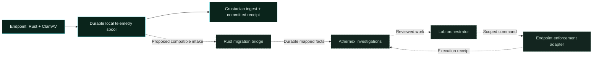

# Project Crustation → Athernex

**Endpoint protection, shared investigations and governed orchestration.**

[Platform overview](siem-enterprise.md) · [Integration contracts](siem-integrations.md) · [Lab roadmap](../README.md#big-push-roadmap)

Project Crustation is being migrated into Athernex’s agentic SIEM and orchestration layer. The source project is published as [**Project Crustacian**](https://github.com/CharlesDerek/crustacian); this document uses “Crustation” for the migration initiative and preserves the repository’s spelling for its existing interfaces.

> **Status: migration work in progress; compatibility bridge and cutover planned.** Both projects have working components. This lab does not yet ingest Crustacian’s native batch envelope or execute endpoint response through a SIEM grant. This brief records the integration findings and the gates for implementing that connection.

## The intended result

Keep scanning close to the endpoint. Bring selected security facts, source health and evidence references into Athernex. Give analysts one investigation trail across ordinary infrastructure activity, endpoint AV findings and agent actions. Route approved work through the lab’s orchestration contracts, with a scoped authorization checked by the component that performs the action.

Crustacian’s Rust endpoint code and ClamAV scanning remain valuable components. The migration is about joining their evidence and control paths to the lab, not turning the SIEM event encoder into an antivirus engine.

*Solid edges describe the source project’s existing telemetry path. Dashed edges are migration work. Athernex cases and the lab orchestrator exist separately; the endpoint connections between them are planned.*

## Assets to carry forward

The source repository’s README, `docs/ingest-server.md`, `schemas/endpoint-event.schema.json` and `schemas/ingest-batch.schema.json` establish these starting contracts:

| Existing component | Migration value |
| --- | --- |
| Rust scan wrapper, ClamAV and FreshClam | Local AV scanning and signature updates |
| Structured scan results and NDJSON spool | Endpoint collection with bounded, inspectable delivery state |
| Endpoint telemetry and forensic snapshot SHA-256 | Evidence references that can survive a change of transport |
| HTTPS sender, private CA / client-certificate options | Transport controls to preserve when moving beyond loopback |
| Endpoint-bound ingest credentials | Producer identity separate from analyst and task authority |
| SQLite ingest receipt and persistent replay detection | Delivery semantics that must survive the migration |
| Disabled response-plan drafts | Proposals that can enter review without becoming execution authority |

These are source-project interfaces, not a claim that this lab has imported their implementation or reproduced its guarantees.

## Finding 1 · Acknowledgement is a correctness boundary

**A direct URL replacement would weaken delivery guarantees.** Crustacian acknowledges after its ingest transaction commits; its sender can use that acknowledgement to advance the spool. Athernex’s current normalized-event API acknowledges buffered acceptance before the periodic telemetry archive commit. A process crash in that interval can lose accepted facts.

| Contract | Crustacian source | Athernex current API | Migration requirement |
| --- | --- | --- | --- |
| Body | Versioned batch envelope | Array of normalized events | Explicit schema/version adapter |
| Batch size | 1–1,000 events | At most 256 events / 256 KiB | Bounded splitting with receipt coverage for every event |
| Delivery receipt | After ingest transaction commits | After buffered acceptance | Durable receipt before advancing endpoint spool |
| Replay identity | Persistent `(endpoint_id, event_id)` | `(source, idempotency_key)` within hot ring | Bounded persistent replay ledger with a declared replay horizon |
| Backpressure | Structured retry hints and durable retry scheduling | HTTP errors; no equivalent durable receipt protocol | Preserve backoff, retry intent and explicit overload behavior |
| Ordering | Endpoint/batch identities available | Arrival order and bounded time admission | Define late delivery and per-endpoint sequencing |

**Proposed design:** a Rust compatibility intake atomically commits a receipt, full replay identity and a pending normalization record before acknowledging. A bounded durable queue drives SIEM insertion, with explicit completion and recovery state. The implementation must prove that a crash between these steps neither loses an acknowledged endpoint event nor creates unbounded duplicate cases. A durable staging write alone does not solve the downstream handoff.

The endpoint must keep its spool until that stronger receipt exists. The current SIEM `200` response is insufficient for migration cutover.

## Finding 2 · Preserve meaning before compressing it

Crustacian’s native event schema is `crustacian.endpoint.telemetry.v0`; its batch schema is `crustacian.ingest.batch.v0`. They are not aliases for the SIEM’s six current event families.

| Endpoint field | Proposed treatment | Constraint |
| --- | --- | --- |
| `endpoint_id`, `event_id` | Full durable source/replay identity | Do not truncate into a display label or a 32-bit trace |
| `timestamp` | Normalized event time plus receipt time | Specify parsing, clock skew and delayed-spool policy |
| `asset_hostname`, `platform`, `actor`, `auth_provider` | Typed endpoint identity/provenance extension | Current API labels are 64-character ASCII; collisions must be handled explicitly |
| `event_kind`, `severity` | Versioned mapping with declared semantics | Native AV findings need an endpoint event contract; do not disguise malware as an authentication failure |
| `classifier`, `confidence` | Preserve classifier identity and numeric confidence | Confidence is neither severity nor authority |
| `forensic_snapshot_sha256` | Full SHA-256 in a typed evidence reference | Preserve every digest bit; the original snapshot stays in its controlled evidence store |
| `evidence` | Bounded summary and resolvable evidence reference | No automatic copying of raw files or unbounded text into the hot ring |
| `lockout_recommended`, `isolation_recommended` | Untrusted response suggestions for review | Never an instruction to execute a privileged action |

The journal-only `context` field is not an extension slot for endpoint events. A typed endpoint schema and archive version must be designed and validated before these fields are admitted. AEF1’s short codes remain a compact representation of selected facts; they do not replace identity, evidence integrity or access controls.

## Finding 3 · Observation and execution need separate credentials

An endpoint ingest credential proves who may submit observations. An operator session authorizes investigation management. A task grant authorizes one bounded operation. These credentials must remain separate throughout the migration.

Future endpoint commands should carry an exact endpoint, typed action, task identity, deadline, replay identifier and approved evidence reference. The enforcing endpoint adapter must check them when the command arrives, including after reconnect or restart. A queued command must not outlive its grant. A response receipt should record what actually happened, including refusal or partial failure, and attach to the investigation.

The existing SIEM gateway can enforce access to its own findings, evidence, rules, archive inventory and lab notebook. It does not yet enforce scan requests, file quarantine, process termination or network isolation. Those capabilities require explicit adapters and separate acceptance tests.

## Implementation sequence

| Phase | Deliverable | Exit evidence |
| --- | --- | --- |
| 1 · Contract fixtures | Rust mapping specification, versioned endpoint facts and public synthetic examples | Every required source field is preserved, referenced or explicitly rejected |
| 2 · Passive delivery | Compatible intake, durable receipts, bounded queue and persistent replay state | Crash/retry/duplicate tests demonstrate no loss of acknowledged facts |
| 3 · Correlation parity | Endpoint findings linked to source health, agent activity and preserved cases | Known fixtures produce explainable findings without identity collisions |
| 4 · Reviewed orchestration | SIEM-to-orchestrator work reference, fenced dispatch and result receipts | Duplicate delivery and stale work cannot execute twice |
| 5 · Endpoint enforcement | Narrow typed actions with independent endpoint authorization | Expiry, revocation, disconnect and restart refuse stale authority |
| 6 · Pilot cutover | One controlled endpoint cohort, observable rollback and measured budgets | End-to-end delivery counts reconcile before the old path is retired |

All six phases are migration deliverables; they are not marked complete by publishing this plan. During a pilot, avoid activating two response paths for the same endpoint. Preserve a way to resume the existing ingest route without deleting queued evidence.

## Resource and failure budgets

- **Keep bulk data at its source.** Scan inputs, signature databases and forensic snapshots stay outside the SIEM hot ring and this public repository.
- **Budget each queue independently.** Endpoint spool, bridge queue, replay ledger, archive, case evidence and WAL need explicit capacities and overload behavior.
- **Measure the complete footprint.** Report mapped payload, dictionary/provenance overhead, database pages, peak RAM, retry traffic and receipt latency.
- **Exercise failure boundaries.** Test a crash before/after receipt, lost response, replay after restart, full storage, malformed batches, expired grants, missing evidence and clock skew.
- **Publish controlled evidence.** Use synthetic endpoint fixtures, small benchmark outputs and actual console screenshots. Never add endpoint samples, raw journals, credentials or model weights to the repository.

## Acceptance before cutover

- [ ] Native schemas have explicit compatibility versions and field-level mapping tests.
- [ ] Endpoint identities and SHA-256 references survive round trips without truncation.
- [ ] A durable receipt covers every acknowledged event, including split batches.
- [ ] Replay and overload limits are visible and recoverable after restart.
- [ ] A failed or disconnected endpoint is distinguishable from an endpoint reporting no detections.
- [ ] Recommendations cannot bypass review or grant authority.
- [ ] Endpoint actions require an unexpired scoped command and return a verifiable result receipt.
- [ ] Pilot delivery counts reconcile; rollback and storage budgets are documented.

---

[Source project: Crustacian](https://github.com/CharlesDerek/crustacian) · [Available SIEM integrations](siem-integrations.md) · [Athernex research findings](../README.md#research-findings)
