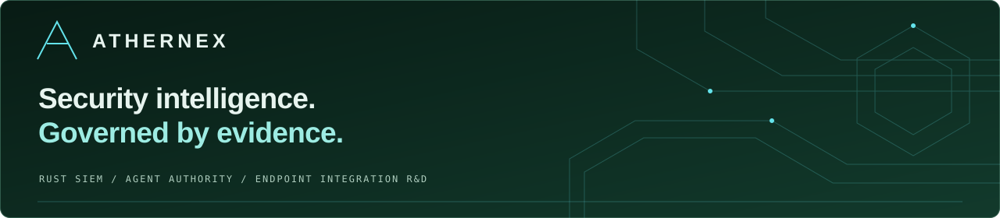
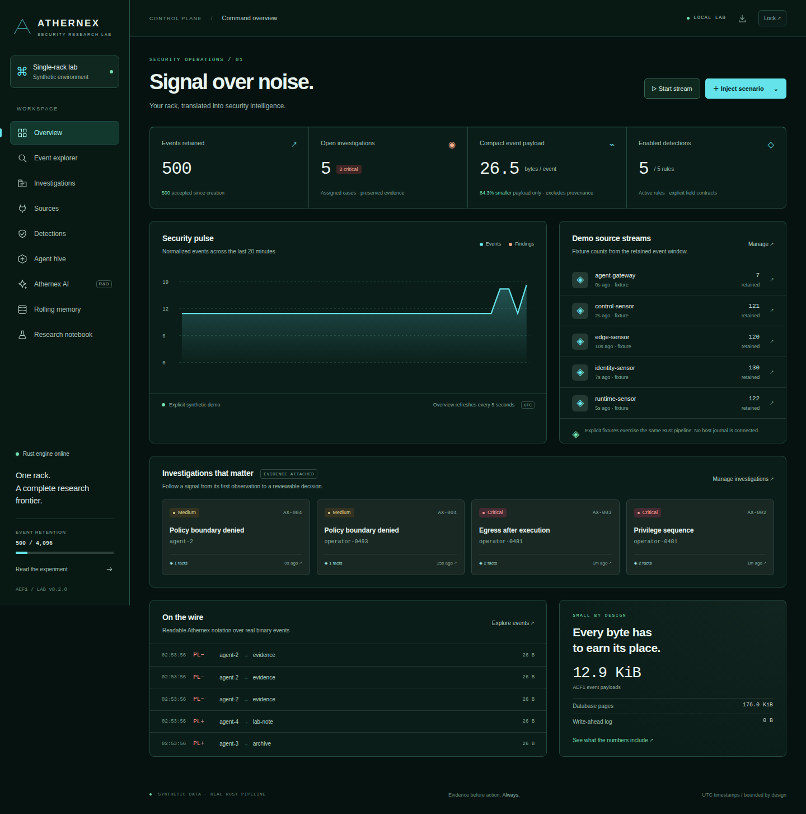
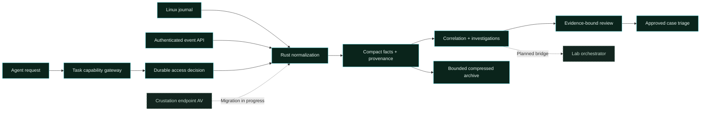
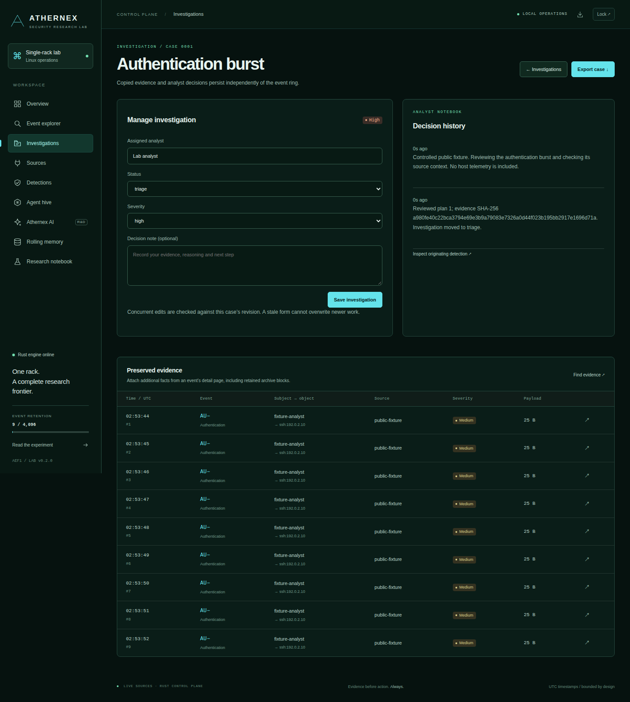
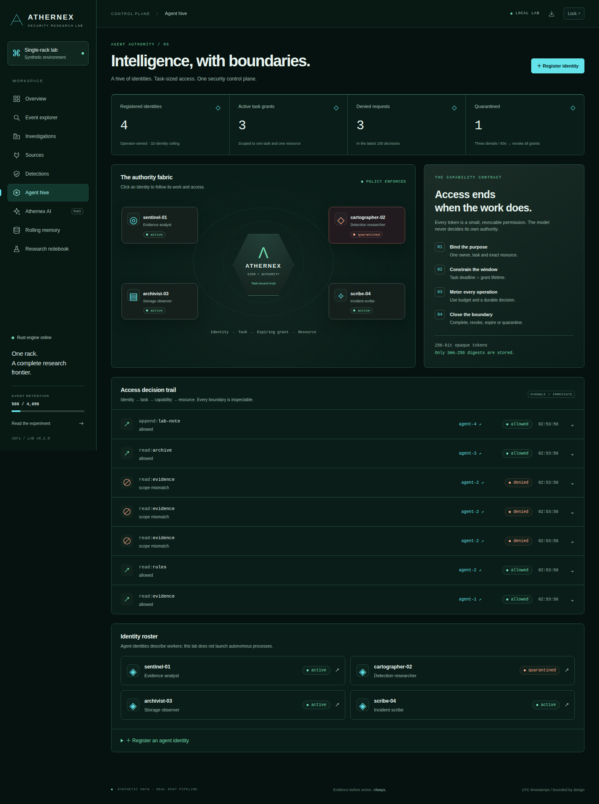
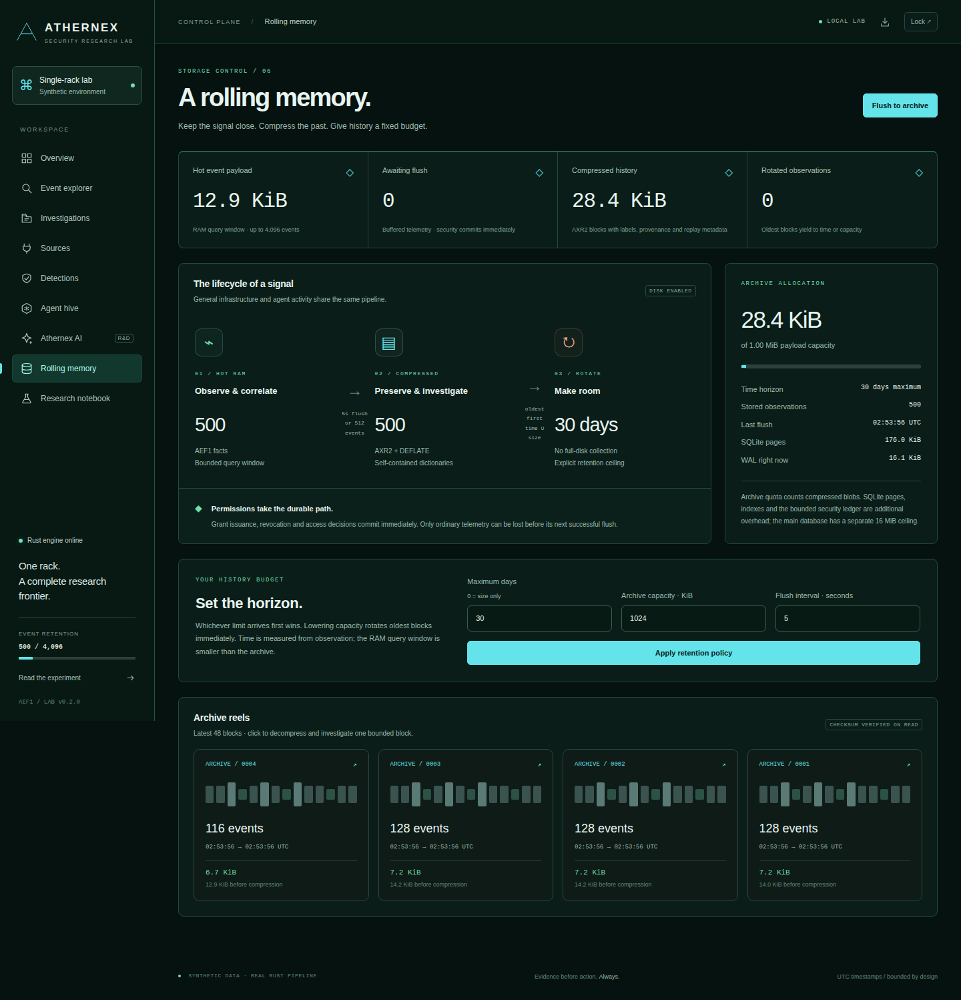

# Athernex SIEM · Platform overview

**Host evidence. Accountable agents. A common investigation layer.**

[Integration catalog](siem-integrations.md) · [Project Crustation migration](crustation-migration.md) · [Deployment guide](../README.md#deploy-on-linux-with-systemd) · [Research notebook](../README.md#research-findings)

Athernex brings security observation and agent access decisions into one Rust control plane. Analysts can follow a signal from a connected source into a preserved case, review its evidence, and manage the task credentials involved. The broader lab is researching how security, endpoint protection and workload orchestration can share a single rack’s resource budget.

> **Delivery status:** deployable single-host SIEM and local capability gateway. Endpoint convergence with Project Crustation is work in progress. Distributed response, model-backed reasoning and enterprise identity federation remain research and integration work.

## The operating picture

*Actual Rust console, captured with the explicit synthetic demo. All screenshots in this document use controlled public fixtures; they contain no host telemetry or credentials.*

| Operational need | Available today | What an analyst can inspect |
| --- | --- | --- |
| Understand incoming activity | Linux journald and authenticated normalized-event sources | Source health, receipt counters, cursor state and errors |
| Investigate a signal | Five rule contracts and independent investigation cases | Decoded facts, provenance, assignments, notes and copied evidence |
| Control agent access | Identities, tasks and expiring capabilities | Exact resource scope, deadlines, use budgets and decision trails |
| Retain a bounded history | RAM query window and compressed AXR2 archive | Time/size policies, pending telemetry, archive blocks and physical overhead |
| Review a proposed action | Deterministic, evidence-bound plans | Approval, expiry, rejection and a committed case-triage receipt |
| Connect endpoint protection | **Migration in progress** from Project Crustation / Crustacian | [Mapping, delivery guarantees and acceptance gates](crustation-migration.md) |

## From observation to accountable action

The gateway currently enforces resources inside the SIEM. An agent grant does not confer filesystem, endpoint isolation, Kubernetes or remote-tool authority. Those operations require adapters that enforce the same identity, task, scope and expiry checks at execution time.

## Investigation workspace

Assign a case, record a decision, attach additional facts, and export the result. Evidence copies have an independent lifecycle, so ordinary rolling retention does not erase an open investigation. Revision checks prevent a stale form from overwriting newer work. Closing a case invalidates pending approvals.

## Agent authority

Every grant belongs to one task, one identity and one exact resource/operation. It expires at the earlier of its own deadline and the task deadline. Completing a task or quarantining an identity revokes its grants. Access decisions and policy effects commit together; a failed decision write cannot consume a use and quietly omit the audit record.

## An explicit storage budget

The default hot window holds 4,096 facts. The archive defaults to 1 MiB of compressed payload and a 30-day maximum horizon, subject to capacity. SQLite pages, dictionaries, provenance, cases and WAL are separate costs. This is a retention policy, not a promise that arbitrary traffic fits into a fixed number of kilobytes.

## Integration direction

**Project Crustation is being migrated into the agentic SIEM and the lab’s orchestration layer.** The source repository is published as [Project Crustacian](https://github.com/CharlesDerek/crustacian), a Rust endpoint project using ClamAV with endpoint telemetry and its own ingest path. The migration brings endpoint evidence into shared investigations first; governed endpoint response follows only after delivery, schema and authorization contracts are proven.

The existing lab orchestrator supplies separate Kafka adapters, durable capacity leases, an outbox and staging contracts. Joining that orchestration path to SIEM findings is planned; it is not wired into this console yet. [The integration catalog](siem-integrations.md) identifies each working and proposed boundary.

## Evaluation and adoption

1. **Install locally.** Use [the systemd user-service installer](../tools/install-siem-user.sh); keep the loopback listener and private state directory.
2. **Validate the source.** Confirm journal permissions, source health and original-record retrieval. Zero findings can be a legitimate result.
3. **Exercise the workflow.** Use a separate `--demo` ledger for cases, capability expiry, quarantine and archive inspection.
4. **Evaluate failure behavior.** Review buffer-loss limits, checkpoint recovery, finite dictionaries and case budgets before choosing a workload.
5. **Expand integrations deliberately.** Preserve source semantics and delivery guarantees; require a verified enforcement adapter before enabling external response.

This repository is a working research platform. Multi-tenant access, SSO, fleet identity, high availability, independently anchored audit, remote response and whole-rack performance validation are open work.

---

[Explore every integration](siem-integrations.md) · [Follow the endpoint migration](crustation-migration.md) · [Run the lab](../README.md#run-the-siem)
