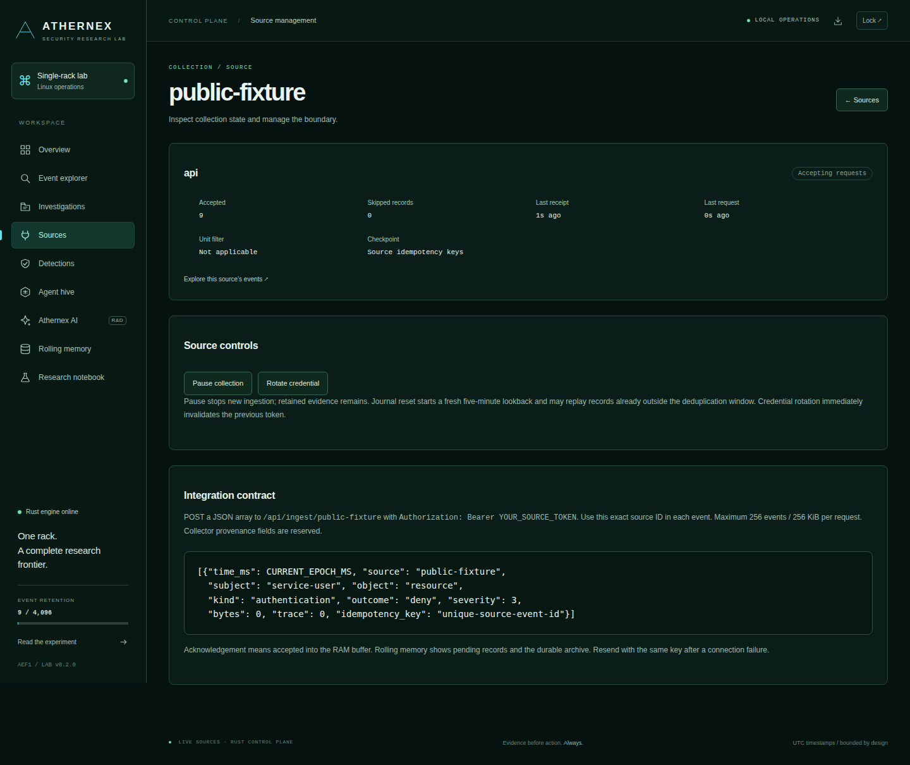
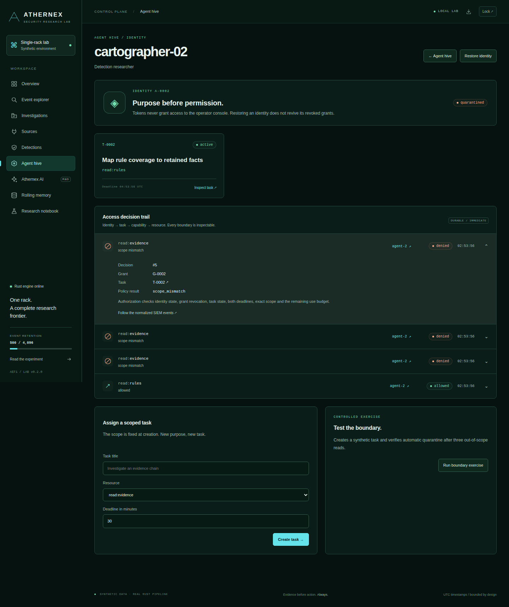

# SIEM integrations · Contracts and delivery status

[Platform overview](siem-enterprise.md) · [Crustation migration](crustation-migration.md) · [Deployment](../README.md#deploy-on-linux-with-systemd)

A useful integration preserves the meaning of an event, the identity of its source and the delivery guarantee its producer relies on. This catalog separates callable interfaces from work in progress.

## Integration catalog

| Connection | Status | Implemented or intended boundary |
| --- | --- | --- |
| Linux system/authentication journal | **Available** | Local `journalctl` adapter; trusted metadata classification; cursor committed with archive |
| Normalized event producers | **Available** | Source-specific bearer credential → `POST /api/ingest/{source-id}` |
| Agent workers | **Available for SIEM resources** | Task capability → exact gateway operation; workers are registered, not launched by the hive |
| Analyst workflows | **Available** | Authenticated console; cases, notes, evidence, review and JSON exports |
| systemd operations | **Available** | Private user service; liveness/readiness; graceful flush and restart |
| Project Crustation / Crustacian | **Migration in progress** | Endpoint AV and telemetry → proposed Rust compatibility bridge → SIEM cases |
| Lab orchestrator / Kafka | **Separate implementation; SIEM bridge planned** | Findings → reviewed work → durable capacity/outbox/fencing contracts |
| Kubernetes and power control | **Staging contracts / private adapters** | No SIEM token currently authorizes cluster or physical rack actions |
| Paperclip | **Separate lab adapter; SIEM task bridge planned** | Work ownership and review concepts inform Athernex; no drop-in Paperclip API compatibility |
| Model providers | **R&D** | Structured proposals with evidence references; current SIEM planner is deterministic |
| OTLP / OCSF / Sigma, Splunk HEC, Elastic, Sentinel, Suricata | **Not implemented in the SIEM** | Candidate adapters and compatibility work; no connector is implied by the generic JSON API |

## 01 · Linux journal

**Boundary:** the service account’s readable journal → bounded Rust normalization → AEF1 facts and AXR2 provenance.

- First connection reads a five-minute lookback; subsequent reads follow a journal cursor.
- Reads are bounded to 256 records / 512 KiB, with a 64 KiB line budget and a three-second read deadline.
- Trusted executable metadata gates OpenSSH, PAM and sudo classification. Unmatched records remain system observations.
- System-manager service-failure detection requires collector provenance; an API caller cannot supply it.
- Raw message text is not archived. An operator may retrieve the exact referenced record while the OS journal retains it.
- The cursor and archive commit together. Journal rotation, invalid records and the 24-hour intake window still limit replay coverage.

[Implementation: collector](../core-engines/siem/src/collector.rs) · [Source lifecycle](../core-engines/siem/src/operations.rs)

## 02 · Authenticated event producers



Create an **API source** under **Sources**. Copy its one-time credential to the producer’s private secret store. The operator key and an agent task token are not ingest credentials.

```http
POST /api/ingest/application-security
Authorization: Bearer <source credential>
Content-Type: application/json
```

The request body is an array. Replace the example timestamp with current epoch milliseconds; the values below are public fixtures.

```json
[
  {
    "time_ms": 1792000000000,
    "source": "application-security",
    "subject": "fixture-user",
    "object": "control-api",
    "kind": "authentication",
    "outcome": "deny",
    "severity": 3,
    "bytes": 0,
    "trace": 42,
    "idempotency_key": "fixture-event-001"
  }
]
```

| Contract | Current behavior |
| --- | --- |
| Source binding | Every event must match the source ID in the URL; journal and internal gateway sources reject API impersonation |
| Batch | At most 256 events and 256 KiB HTTP body |
| Event families | `authentication`, `process`, `network`, `policy`, `heartbeat`, `system` |
| Outcomes / severity | `allow`, `deny`, `observe`; severity 1–5 |
| Labels and replay key | 1–64 ASCII letters, digits or `-_.@:/` characters |
| Time admission | Up to 24 hours old or 60 seconds ahead of the intake clock |
| Idempotency | `(source, idempotency_key)` while the event remains in the hot ring; conflicting facts reject the batch |
| Provenance | `context` is reserved for the journal collector and rejected on API ingestion |
| Pause / rotation | Pause refuses intake; credential rotation invalidates the prior token immediately |
| Success | Counts accepted and duplicate events; **acknowledges buffered acceptance, not durable archive commitment** |

Malformed batches fail atomically. Authentication errors, paused-source errors and request-size rejection must not be treated as successful delivery. The service does not yet expose a durable delivery receipt or an unbounded source-sequence deduplication ledger. A producer that deletes its spool only after a durable acknowledgement needs an additional adapter contract before cutover.

The legacy `/api/ingest` endpoint and `ATHERNEX_INGEST_TOKEN` environment variable apply only to explicit demo mode.

[HTTP routes](../core-engines/siem/src/web.rs) · [Event schema](../core-engines/siem/src/model.rs) · [Archive contract](../README.md#rolling-memory-with-an-explicit-budget)

## 03 · Agent capability gateway



An operator registers an identity, creates a task and issues a grant. Workers call the gateway with that grant as a bearer token. Issuance happens through the operator console; there is no agent self-enrollment or autonomous worker launcher.

| Route | Required task scope | Result |
| --- | --- | --- |
| `GET /api/gateway/finding-N` | `read:finding-N` | One retained finding and its evidence |
| `GET /api/gateway/evidence` | `read:evidence` | Retained finding collection |
| `GET /api/gateway/rules` | `read:rules` | Enabled detection identifiers |
| `GET /api/gateway/archive` | `read:archive` | Archive policy and block inventory |
| `POST /api/gateway/lab-note` | `append:lab-note` | Append `{"text":"..."}`; printable text limited to 256 bytes |

Grants have a 1–3,600-second lifetime and a 1–1,000-operation budget, bounded by the task deadline. The gateway evaluates identity, task, grant, exact resource, action, expiry and remaining uses on each request. Three recognized-identity denials within 60 seconds trigger quarantine and revoke its grants. Unknown tokens cannot choose another identity to quarantine.

**Authority stops at the gateway.** A future endpoint agent must enforce a separately scoped command at the endpoint. It must not translate a `read:evidence` token into file quarantine, process termination or host isolation.

[Policy implementation](../core-engines/siem/src/gateway.rs) · [Identity and session boundary](../core-engines/siem/src/auth.rs)

## 04 · Analyst and operations interfaces

| Interface | Access | Purpose |
| --- | --- | --- |
| `/sources`, `/source/{id}` | Operator | Configure and inspect sources |
| `/cases`, `/case/{id}` | Operator | Assign, annotate, attach evidence, change state and export |
| `/api/state`, `/api/events` | Operator | Snapshot and filtered hot-event inspection |
| `/api/export`, `/api/cases/{id}/export` | Operator | JSON exports; treat live exports as private |
| `/event/{id}/original` | Operator | On-demand exact journal lookup; archived events supply a block reference |
| `/healthz` | Public, loopback | Process liveness |
| `/readyz` | Public, loopback | Configured collection readiness; 503 on reported storage/journal failure or stale journal poll |

Console mutations use authenticated POSTs with CSRF and origin checks; bearer APIs enforce their own credential boundary. The current operator model is one local authority, with one-hour sessions. JSON snapshots are inspection/export interfaces, not a versioned enterprise management SDK. Reverse proxies, identity federation and multi-user roles require further design.

## 05 · Endpoint and orchestration convergence

The **Project Crustation migration** is bringing the Rust endpoint AV project [Crustacian](https://github.com/CharlesDerek/crustacian) toward this shared SIEM and orchestration layer. Its batch envelope, telemetry schema, acknowledgement semantics and response suggestions differ from the SIEM contract. A direct URL change is not a compatible migration. [The migration brief](crustation-migration.md) records the required mappings and gates.

The lab’s [agent-system RFC](../architecture/RFC-001-scalable-agent-system.md) declares `security.findings`, `agent.commands`, `agent.review` and related topics. The [orchestrator](../core-engines/orchestrator/src) contains durable capacity and outbox mechanisms. A future SIEM bridge should publish a reviewed work reference, use consumer deduplication and fencing, and record the execution result back into the case. Those links are not currently executed by the SIEM.

## Connector acceptance checklist

- Document field provenance and every lossy transformation; reject unsupported semantics explicitly.
- Bind source identity independently of event text, operator sessions and task grants.
- Define acknowledgement, retry, ordering, duplicate and partial-failure behavior.
- Bound the spool, batch, concurrency, labels and evidence retention independently.
- Exercise expired/revoked credentials, duplicate replay, crash recovery and a missing evidence source.
- Require a result receipt from the enforcing adapter before declaring an external action complete.

---

[Platform overview](siem-enterprise.md) · [Endpoint migration plan](crustation-migration.md) · [Back to the lab](../README.md)
